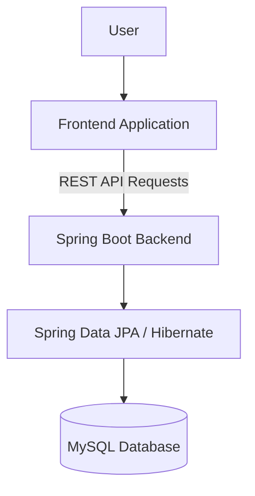

# 🎬 BMS – Movie Ticket Booking Application

A full-stack Movie Ticket Booking System built using **Java 21, Spring Boot, MySQL, and JavaScript**. The application allows users to explore movies, view available shows, select seats, and manage bookings through an interactive interface.

🔗 **Live Demo:** https://dreamy-gnome-0110e3.netlify.app

---

## 📌 Project Overview

BMS is a web-based movie ticket booking application designed to simplify the movie booking experience.

The application provides movie and show management, interactive seat selection, booking and cancellation workflows, and an administrative interface.

The backend is built with Spring Boot and exposes REST APIs, while MySQL handles persistent data storage.

---

## ✨ Features

- 🎥 **Movie Management** – Browse and manage movie information.
- 🕒 **Show Management** – View available movie shows.
- 💺 **Interactive Seat Selection** – Select seats through an interactive seat map.
- 🎟️ **Booking Management** – Create and manage movie ticket bookings.
- ❌ **Booking Cancellation** – Cancel existing bookings and restore seat availability.
- ⚙️ **Admin Panel** – Manage application data through an administrative interface.
- 🔄 **REST API Integration** – Connect frontend operations with backend services.
- 🗄️ **Relational Database** – Store application data using a structured nine-table MySQL schema.

---

## 🛠️ Tech Stack

| Category | Technologies |
|---|---|
| Language | Java 21, JavaScript |
| Backend | Spring Boot |
| ORM | Spring Data JPA, Hibernate |
| API | REST APIs |
| Database | MySQL |
| Containerization | Docker |
| Frontend | HTML, CSS, JavaScript |
| Deployment | Render, Aiven, Netlify |

---

## 🏗️ Architecture

The application follows a frontend–backend architecture.



### Deployment Architecture

- **Frontend:** Netlify
- **Backend:** Render (Docker deployment)
- **Database:** Aiven MySQL

---

## 🗃️ Database Design

The application uses a relational MySQL database with nine tables to organise its core entities and booking-related information.

Database operations are managed through Spring Data JPA and Hibernate entity mappings.

The database design supports:
- Movie and show information.
- Seat availability and booking records.
- Booking and cancellation workflows.
- Relationships between application entities.

---

## ⚙️ Key Technical Implementations

### 1. Transactional Booking Workflow

Implemented booking operations using transactional database workflows to maintain consistency during seat reservations.

### 2. Seat Availability Management

Managed seat availability during booking and cancellation operations to keep booking information consistent.

### 3. JPA and Hibernate Mapping

Used entity relationships and ORM-based database operations to connect Java application models with MySQL tables.

### 4. REST API Development

Developed backend REST APIs to support movie, show, seat availability, booking, and cancellation operations.

---

## 🚀 Running Locally

### Prerequisites

- Java 21
- MySQL
- Maven
- Git

### 1. Clone the repository

```bash
git clone https://github.com/AbhisekDash01/BMS.git
cd BMS
```

### 2. Configure the database

Create a MySQL database for the application.

Configure your database connection in the backend's application configuration.

Example configuration:

```properties
spring.datasource.url=jdbc:mysql://localhost:3306/your_database
spring.datasource.username=your_username
spring.datasource.password=your_password
```

Use your own local credentials. Do not commit passwords, API keys, or other secrets to GitHub.

### 3. Run the backend

From the backend project directory, run:

```bash
mvn spring-boot:run
```

If the project includes a Maven wrapper, you can use:

```bash
./mvnw spring-boot:run
```

On Windows:

```bash
mvnw.cmd spring-boot:run
```

### 4. Run the frontend

Open the frontend project and follow its included setup instructions to run it locally.

---

## 🌐 Deployment

The application is deployed using the following services:

| Component | Platform |
|---|---|
| Frontend | Netlify |
| Backend | Render |
| Database | Aiven |
| Backend Container | Docker |

🔗 **Live Application:** https://dreamy-gnome-0110e3.netlify.app

---

## 📚 What I Learned

Through this project, I gained practical experience in:

- Building RESTful backend applications using Spring Boot.
- Designing relational database schemas using MySQL.
- Working with JPA, Hibernate, and entity relationships.
- Implementing transactional booking workflows.
- Connecting frontend applications with backend REST APIs.
- Containerising and deploying a backend application.
- Managing application data and deployment configuration.

---

## 🔮 Future Improvements

- User authentication and role-based authorisation.
- Online payment gateway integration.
- Automated backend testing.
- Improved booking concurrency handling.
- Booking history and user account management.

---

## 👨‍💻 Author

**Abhisek Dash**

B.Tech Computer Science & Technology Student  
Interested in Java Backend Development and Full-Stack Engineering.

- GitHub: [AbhisekDash01](https://github.com/AbhisekDash01)

---

⭐ If you find this project interesting, feel free to explore the repository and live application.
